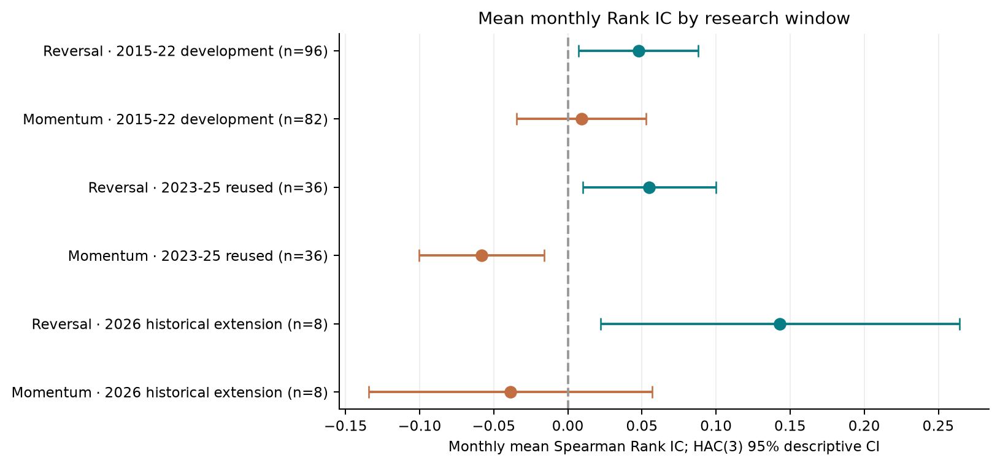
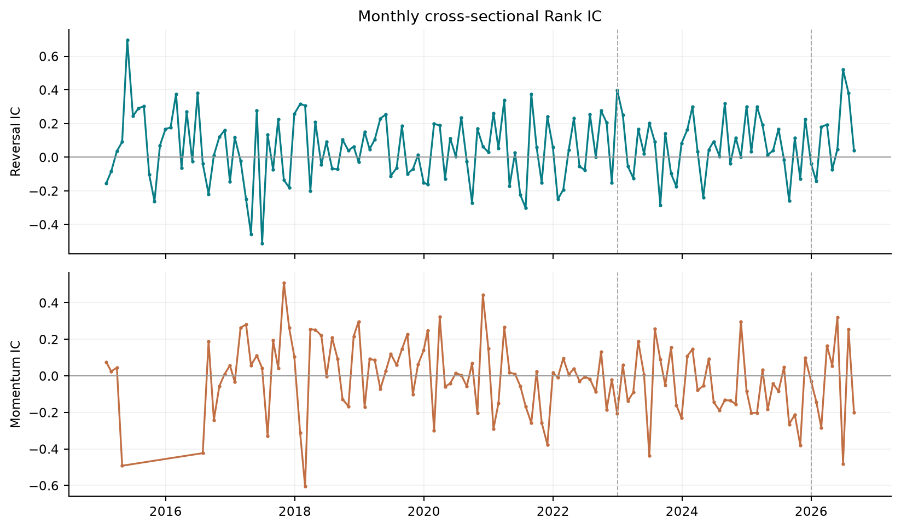
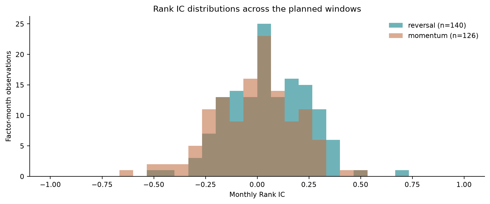
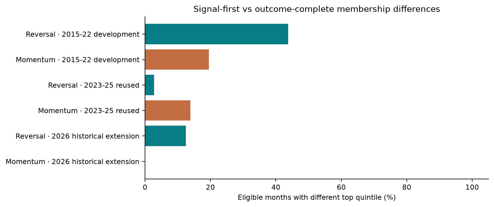
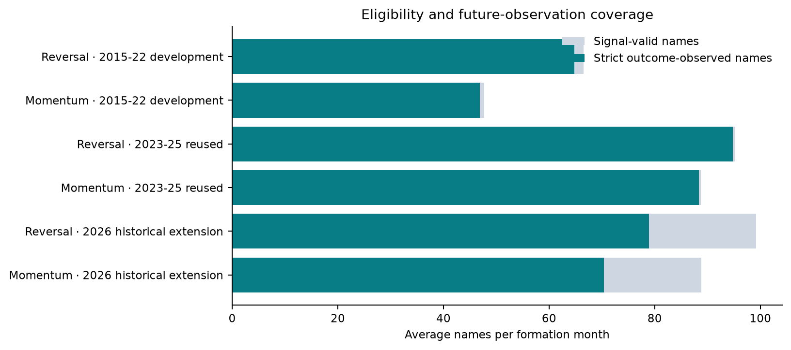
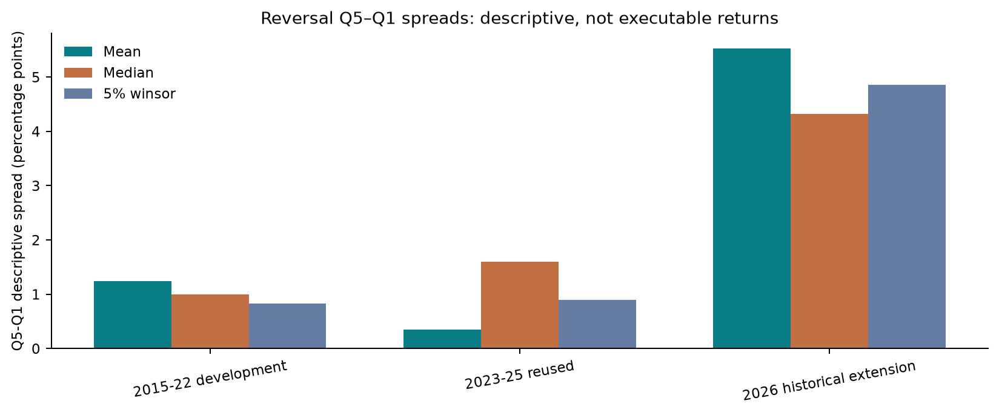

# AlphaLab: Cross-Sectional Momentum and Short-Term Reversal in a Frozen A-Share Sample

**Status:** exploratory price-only associations; not PIT-certified, prospective validation, or investable performance.

**Study:** `Ashare_stratified_hash_20261023`  
**Frozen protocol SHA-256:** `d7a03c7f3d034f333e1af2525ef3204bd1581ac6b0c85ea6ef0d743fbc6743f6`  
**Sample:** 100 currently listed stocks; target 100; seed 20261023; quotas 40/40/15/5.  
**Eligible factor-month rows:** 266.

## Research Motivation

This study describes whether skipped-month momentum and short-term reversal signals are associated with subsequent price changes in a fixed, board-stratified sample of Chinese A-shares. It does not establish causality, market-wide representativeness, or achievable trading profits.

## Data and Sample Construction

The 100-stock sample was selected without replacement from the current candidate roster using a SHA-256 lottery (seed 20261023): Shanghai main board 40, Shenzhen main board 40, ChiNext 15, and STAR 5. Candidate membership includes current listings only and excludes firms delisted before roster collection; the sample therefore has survivorship bias and is not a historical point-in-time (PIT) universe.

The candidate roster is based on BaoStock `query_stock_basic()` retrieved 2026-10-23 with `type=1` and `status=1`: 5,224 current SSE/SZSE records (2,318 SSE, 2,906 SZSE; no BSE records). These third-party fields and counts are not an official exchange completeness certification or a same-date count reconciliation. The source candidate CSV is not included in this public repository, so its recorded source hash and the original lottery cannot be independently verified or reconstructed; analyses can be reproduced from the included frozen 100-stock list. The sample plan was frozen before final data collection but after earlier exploratory work; it is not a prospective preregistration. AKShare/Sina supplies historical raw and retrospective QFQ daily prices and the exchange calendar; it does not define the frozen membership. Observations end at 2026-10-23. Windows are 2015–2022 development, 2023–2025 reused historical evaluation, and 2026 historical extension. The 2023–2025 period is not an untouched holdout; 2026 is not prospective or an independent out-of-sample test.

## Factor Definitions

- Momentum: `P[t−21] / P[t−252] − 1`.
- Short-term reversal: `−(P[t] / P[t−21] − 1)`.
- Forward outcome: price-only `P[t+22] / P[t+1] − 1`, requiring a fully observed forward path.

Here `t` is a month-end exchange session. The frozen analysis loads QFQ close series for both signals and the forward price outcome, using the same adjusted series at the specified session offsets. This is not a raw-price outcome, certified total return, achieved execution, or a transaction-cost-adjusted result. QFQ adjustment vintages are not independently verified.

## Empirical Methodology

Monthly Rank IC is Spearman correlation between a factor and forward price return among complete cases. The estimator requires at least 20 paired names and non-constant factor and return cross-sections; missing values are not imputed. Effective name counts vary. By window (development / reused 2023–2025 / 2026 extension), momentum has 82/36/8 eligible months with 20–77 / 79–94 / 87–90 names; reversal has 96/36/8 months with 23–91 / 91–98 / 97–100 names.

Mean monthly IC uncertainty uses Newey–West/HAC with 3 monthly lags, as frozen in the plan. HAC(3) is a reasonable prespecified short-run serial-dependence adjustment, but it does not solve selection, overlapping horizons, specification search, or small-sample uncertainty. Eight 2026 months are particularly few for asymptotic inference.

Quintile spreads are ex-post complete-case descriptions. A separate signal-first cohort audit assigns groups before future outcomes are known. When outcomes are missing, those group definitions differ; neither is an executable backtest.

## Results and Interpretation

| Signal | Window | Months | Mean Rank IC | HAC(3) 95% interval |
|---|---|---:|---:|---|
| momentum | 2015-22 development | 82 | +0.0091 | [-0.0348, +0.0529] |
| momentum | 2023-25 reused | 36 | -0.0582 | [-0.1006, -0.0158] |
| momentum | 2026 historical extension | 8 | -0.0388 | [-0.1343, +0.0567] |
| reversal | 2015-22 development | 96 | +0.0475 | [+0.0073, +0.0878] |
| reversal | 2023-25 reused | 36 | +0.0549 | [+0.0099, +0.1000] |
| reversal | 2026 historical extension | 8 | +0.1432 | [+0.0220, +0.2643] |

The 2026 reversal Rank IC mean is +0.1432 over eight months (HAC(3) interval +0.0220 to +0.2643); momentum is −0.0388 (−0.1343 to +0.0567). These intervals are descriptive and fragile at this sample size.

## Robustness and Sensitivity

Mean monthly Rank IC was compared under HAC lags 0, 1, 3, and 6 (full estimates: `research_inputs/hac_ic_lag_sensitivity.csv`). For 2026 reversal, the mean remains +0.1432 while 95% intervals are [−0.0023, +0.2886], [−0.0085, +0.2948], [+0.0220, +0.2643], and [+0.0377, +0.2486]. Whether the interval crosses zero depends on lag choice; with only eight months this is not robust significance evidence. HAC(3) remains the frozen primary specification. Regime-interaction sensitivities are separate exploratory estimates and address a different quantity.

The 2026 reversal Q5–Q1 mean spread is +5.53 percentage points per observed horizon across eight months; the average of monthly median spreads is +4.32 points and the average 5%-winsorized spread is +4.86 points. June alone contributes +35.84 points mean (+33.32 median; +31.17 winsorized); its Q1 mean return is −31.56% (5%-winsorized −29.87%) while Q5 averages +4.27% (+1.31% winsorized). This points to broad Q1 underperformance in that month rather than only one Q5 winner, although the tail remains large after winsorization. Excluding June, the seven-month mean is +1.20 points. May is discordant (mean −3.86 points; median −2.82 points) and has large group maximum returns, consistent with noisy tails. Complete-case counts in these months are 97–100, so the June result is not caused by a sharply depleted cross-section. Spreads remain descriptive, not PnL.

The reported 65 top-group mismatches are summed across factor/window cells, not 65 unique calendar months. Reversal mismatches are 42/96 development months, 1/36 reused 2023–2025 months, and 1/8 2026 months; momentum mismatches are 16/82, 5/36, and 0/8. Bottom-group mismatches also occur. These counts do not change the frozen 100-stock sample: they show that names without complete future outcomes cannot enter ex-post complete-case quintiles, changing within-month membership and the estimand.

Signals are measured at close `t`; the code calculates the future price return from QFQ close `t+1` to `t+22`, requiring every session in the forward path. Factors and outcomes therefore share the same QFQ series. Factor ranking does not use the forward outcome, so the source contains no direct outcome look-ahead in ranking; however QFQ is retrospectively adjusted and its vintage is not PIT-certified, and total-return treatment and executable prices remain unverified.

## Limitations

- Current-listed sample has survivorship bias and is not a historical PIT universe.
- 2023–2025 is a reused historical evaluation period, not an untouched holdout; 2026 is a short historical extension, not independent prospective evidence.
- QFQ adjustment vintage and corporate actions are not independently validated; outcomes are not certified total returns.
- Missing outcomes are not imputed. Complete-case spreads condition on future availability; signal-first membership is separately audited.
- Monthly horizons overlap; HAC normal intervals with few months are fragile. Exploratory analyses are not adjusted for specification search or multiple testing.
- No tradability, price-limit, liquidity, shorting, execution, turnover, borrow, or full transaction-cost model is included.
- Raw Sina histories are excluded from the public package; provider data redistribution permission is not established.

## Conclusion

The estimates show positive average reversal Rank IC in the three labelled windows and negative momentum Rank IC in reused 2023–2025; the 2026 momentum estimate is imprecise. The 2026 reversal average is dominated by one strong month and is based on eight observations. These findings do not establish persistent alpha, broad-market validity, timing ability, or investable performance.

## Reproducibility and Data Sources

- Candidate roster: BaoStock `query_stock_basic()` current SSE/SZSE response retrieved 2026-10-23. Historical daily prices and calendar: AKShare/Sina.
- The candidate source CSV is not distributed; the selected sample is included, but the original candidate lottery cannot be independently reconstructed or verified from this package.
- The public repository includes code, the frozen plan and selected sample, aggregate statistics, report, and figures.
- Raw per-stock Sina histories and the private source-checksum inventory are not distributed.

## Figures

